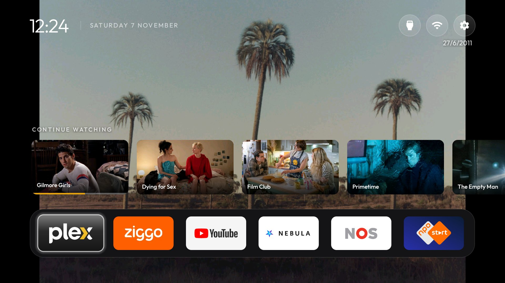
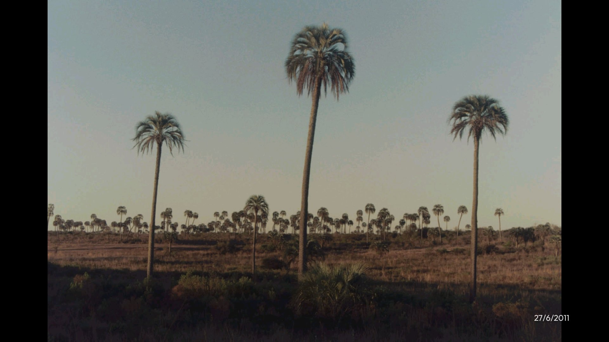
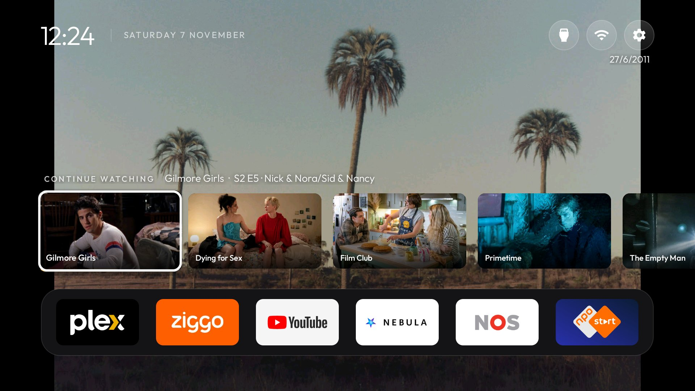
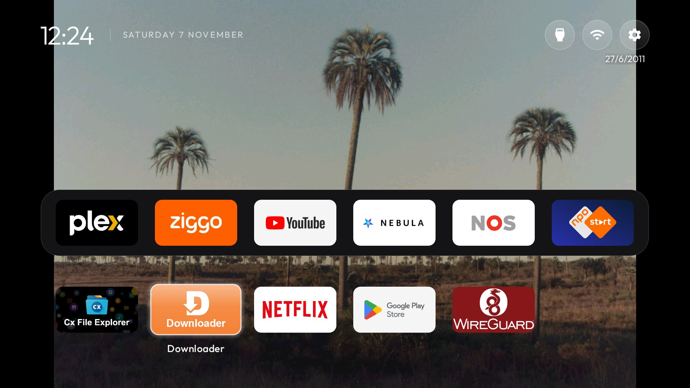

# cleanyourtv — gilgamezh's personal fork

> **Why this fork exists:** to make [cleanyourtv](https://github.com/Gathin23/cleanyourtv) fit **my own
> setup** — one Sony BRAVIA XR-55A80J (Google TV 12) in my living room, my self-hosted Plex and Immich, and the
> way I use the remote. It is not a general-purpose alternative to upstream and isn't meant to be one: the
> changes are opinionated, tested on one TV, and some of them deliberately break upstream's rules (the launcher
> here talks to the network). If you want a clean, offline home screen for your TV, use
> **[upstream cleanyourtv](https://github.com/Gathin23/cleanyourtv)**. If you run Plex and Immich at home and like
> the idea, feel free to borrow from this.

Everything upstream does still applies (the debloat lists, the tools, the reference launcher); its README is
kept as [`README.upstream.md`](README.upstream.md). My changes live on the **`custom`** branch, on top of upstream.



## What's different here

- **Photo-frame home.** The wallpaper is a rotating set of photos from one album on my **Immich** server, shown
  whole (letterboxed, never cropped or stretched), with a small caption — `d/m/yyyy - City, State, CC` —
  like my e-ink PicPak frames. After **8 seconds** without a button press, everything fades away except the photo;
  the first press only brings the home screen back.
- **A Plex row.** "Continue watching" and "Recently added" from my **Plex Media Server**, right above the dock,
  shown only while Plex has focus. OK opens Plex (see *Limits*).
- **A quieter layout.** No greeting, a smaller clock, icon-only buttons, 6 columns, the dock at the bottom edge,
  and the app grid hidden until you press Down.
- **Remote buttons that do something useful.** A tiny separate app (`remotekeys/`, `io.gilgamezh.remotekeys`)
  remaps the remote's **Prime Video** button to Plex and **Disney+** to Ziggo GO, with a key-layout overlay — no
  accessibility service, so holding volume still ramps.
- **Docker builds on hosts without IPv6 in Docker** (`DOCKER_NETWORK=host` in `tools/docker-build.sh`), and
  `tools/shot.sh` to keep a screenshot of each stage in [`screenshots/`](screenshots/README.md).

The debloat list for this TV went upstream instead of staying here:
[Gathin23/cleanyourtv#3482](https://github.com/Gathin23/cleanyourtv/pull/3482) (second unit of the XR-65A80J list).

## Screenshots

From stock Google TV (v0) to photo-frame mode (v5): [`screenshots/README.md`](screenshots/README.md).

| Idle (after 8 s) | Plex row focused | App grid |
|---|---|---|
|  |  |  |

## How it fits together

| Piece | Where | What |
|---|---|---|
| Plex row | `launcher/.../PlexShelf.java` | Continue watching + Recently added (movie and TV sections) from a Plex Media Server on the LAN, as 16:9 cards anchored above the dock. |
| Immich wallpaper | `launcher/.../ImmichSync.java`, `WallpaperPlayer.java` | Lists the album through Immich's timeline API (it covers every member of a shared album; random search is the fallback), keeps a pool of random landscape `preview` images on the TV, writes `captions.txt`, and feeds the wallpaper rotation. Works offline from the cached pool. |
| Photo-frame mode | `MainActivity.java` (`photoFrameKey`, `enterIdle`, `wake`), `config.xml` `photo_frame_idle_seconds` | Idle fade, first-key-wakes, lower dock, grid rows hidden until Down. `0` turns it off. |
| Settings | `launcher/.../Services.java`, `tools/services-setup.sh` | Both features read `services.json` from the launcher's folder on the TV. **No file = the launcher is offline, exactly like upstream.** |
| Remote keys | `remotekeys/` | Key-layout overlay for the Bluetooth remote (`SONY TV VRC 001`): Prime Video (scan 490) → `CALENDAR`, Disney+ (491) → `CONTACTS`, answered by a no-UI activity that opens the target app. |

Layout settings are in `launcher/app/src/main/res/values/config.xml` (dock apps, hidden apps, 6 columns, no
greeting, icon-only pills, no ambient glow) and the clock row in `activity_main.xml`.

## Using it

You need Docker, `adb`, a TV with network debugging on, and (for the extras) a Plex server and an Immich server
the TV can reach.

```bash
# build the launcher in Docker (keep your signing key outside the repo)
DOCKER_NETWORK=host HOST_KEY_DIR=$HOME/.config/tv-launcher/keys tools/docker-build.sh launcher assembleRelease
SKIP_BUILD=1 TV_HOST=<tv ip> launcher/build-and-install.sh

# Plex + Immich settings: put your values in ~/.config/tv-launcher/setup.env (see the top of the script),
# then run it in a terminal; it asks for the Immich API key (album.read, asset.read, asset.view)
TV_HOST=<tv ip> tools/services-setup.sh
#   other knobs: ROTATION_MINUTES, DIM, PHOTOS, FIT=0 (crop instead of letterbox)

# remote keys (Sony remote only; check your scan codes with `adb shell getevent -lt` first)
docker run --rm --network host -u $(id -u):$(id -g) -e HOME=/tmp -v $PWD/remotekeys:/workspace -w /workspace \
  cleanyourtv-android-build ./build.sh
adb install -r remotekeys/out/remotekeys.apk
adb shell 'CLASSPATH=$(pm path io.gilgamezh.remotekeys|cut -d: -f2) app_process /system/bin io.gilgamezh.remotekeys.SetLayout "SONY TV VRC"'
```

Secrets (the Plex token, the Immich API key) only ever live in `~/.config/tv-launcher/services.json` (mode 600)
and in the launcher's private folder on the TV; nothing secret is in this repo.

Before installing anything like this on your own TV, read upstream's advice in
[`SHOWCASE.md`](SHOWCASE.md): build from source, read the manifest (this fork adds `INTERNET` and cleartext HTTP
for the LAN), and turn network ADB off when you're done (`tools/adb-closed.py <tv ip>`).

## Limits and gotchas (on this TV)

- Home only moves to a third-party launcher once **both** Google's launcher (`launcherx`) and the setup wizard
  (`setupwraith`) are disabled; `set-home-activity` alone prints *Success* and changes nothing on Sony VH2 firmware.
  Check which app owns your saved Wi-Fi network before disabling setupwraith (`dumpsys wifi | grep -o 'cname=[^ ]*'`).
- **Plex can't be told to play a specific episode.** The 2026 "New Plex Experience" app accepts `plex://` links
  but lands on its own home, and it dropped "Advertise as player" (nothing listens on port 32500), so a
  `playMedia` command can't start one either. OK on a card opens Plex, where the same title is first in
  Continue Watching.
- Immich's random search skips other members' photos in a shared album; the timeline API doesn't.
- Firmware updates can re-enable packages or give Home back to Google: re-check after one.

## Credits and license

All the heavy lifting — the debloat lists, the tools, the launcher this builds on — is
[Gathin23/cleanyourtv](https://github.com/Gathin23/cleanyourtv) and its contributors. MIT licensed, same as
upstream ([`LICENSE`](LICENSE)).
