# Screenshots — Sony XR-55A80J (Google TV 12)

One file per stage, named `v<version>-<what>.jpg`, taken with `tools/shot.sh`.

| Version | Date | Shot | What |
|---|---|---|---|
| v0 | 07/11/2026 | 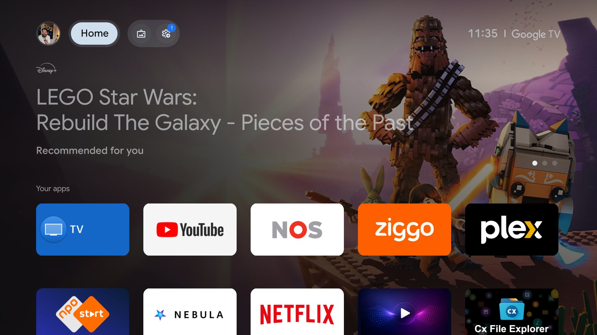 | Stock Google TV home after the debloat, Apps-only mode: one sponsored banner left. Retaken by re-enabling launcherx for a minute; the original "before" shots (full Disney+/Prime banners and recommendation rows, then the "Network error" banner caused by adblock in Apps-only mode) were lost with /tmp. |
| v1 | 07/11/2026 | 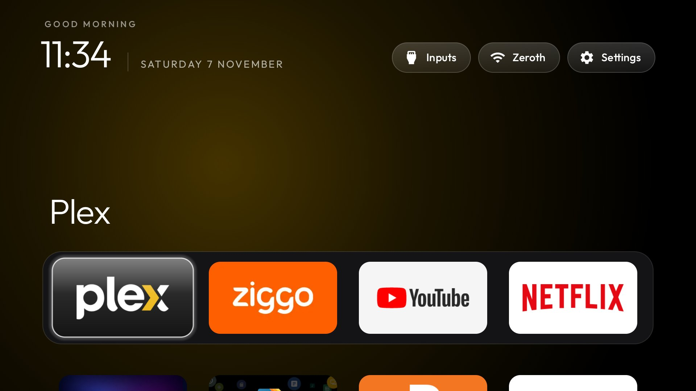 | cleanyourtv reference launcher as Home: no ads; dock Plex / Ziggo / YouTube / Netflix; Inputs / Wi-Fi / Settings pills. |
| v2 | 07/11/2026 | 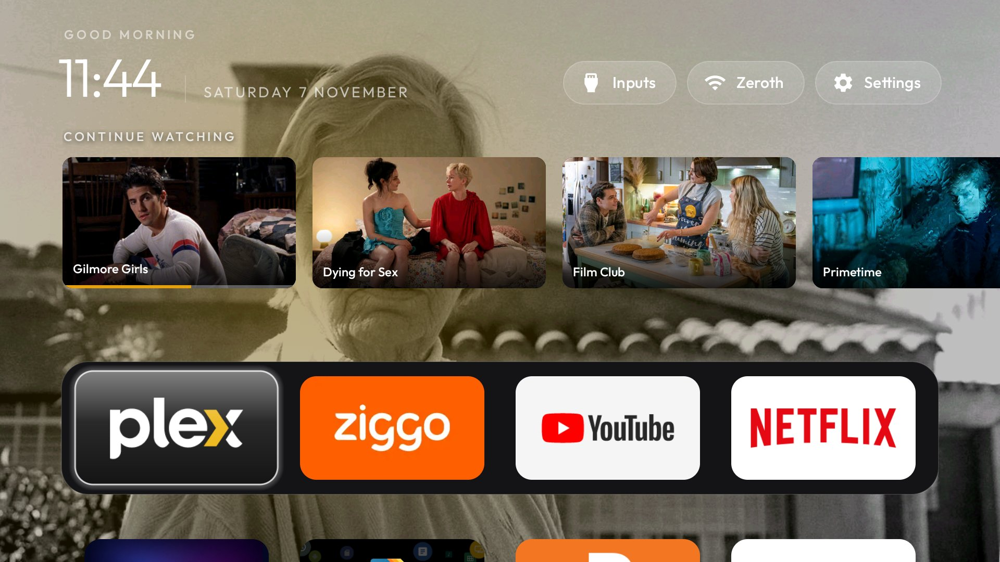 | First Immich + Plex build: photo wallpaper (then the 2-photo Picpak album, dim 25 %) and the Plex shelf. |
| v2 | 07/11/2026 | 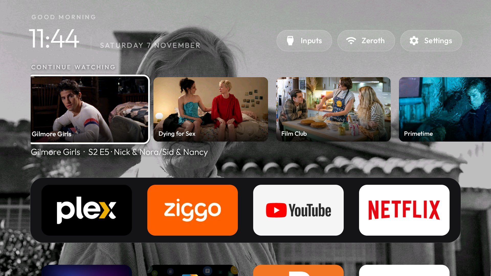 | Shelf focused: progress bar on Continue watching, episode title under the row. |
| v3 | 07/11/2026 | 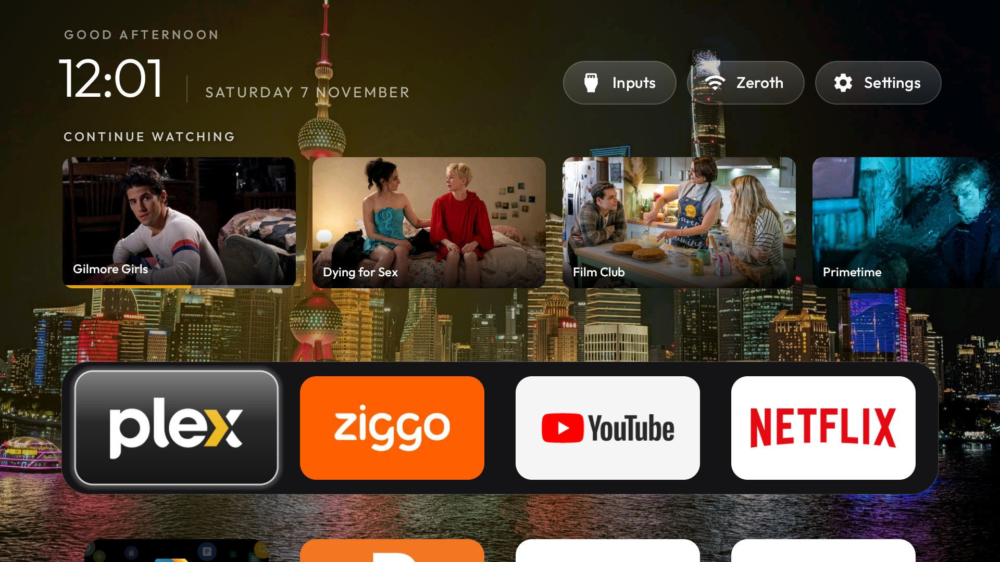 | Wallpaper album switched to the dedicated album; Home with focus on the dock. |
| v3 | 07/11/2026 | 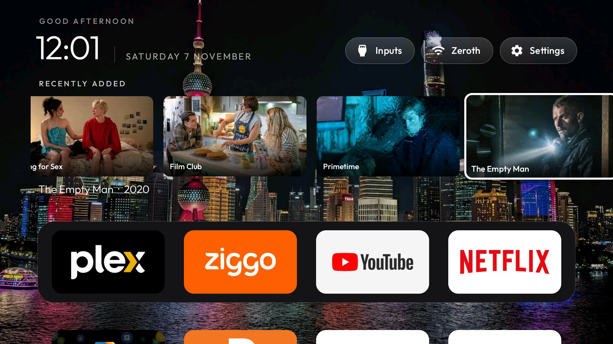 | Shelf scrolled to its last card (Recently added). |
| v3 | 07/11/2026 |  | Down to the dock: the shelf scrolls back to the start and the title line hides. |
| v3 | 07/11/2026 | 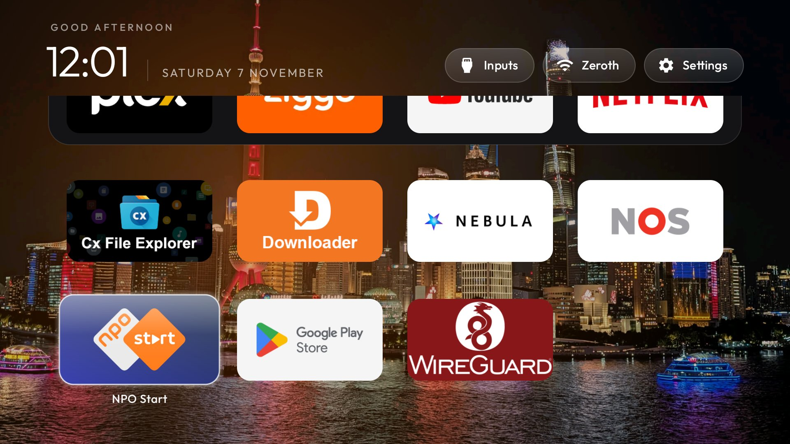 | App grid: the shelf fades out while the grid is scrolled up under the clock. |
| v4 | 07/11/2026 | 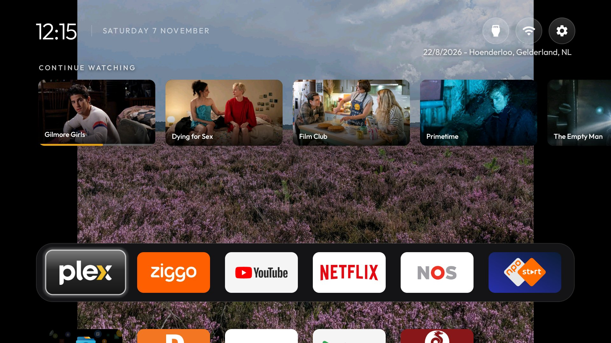 | Compact: no greeting, smaller clock, icon-only pills, smaller Plex cards, 6 columns (dock Plex / Ziggo / YouTube / Netflix / NOS / NPO Start), photo fitted (letterboxed, no crop), no ambient glow, PicPak-style caption under the pills. |
| v4 | 07/11/2026 | 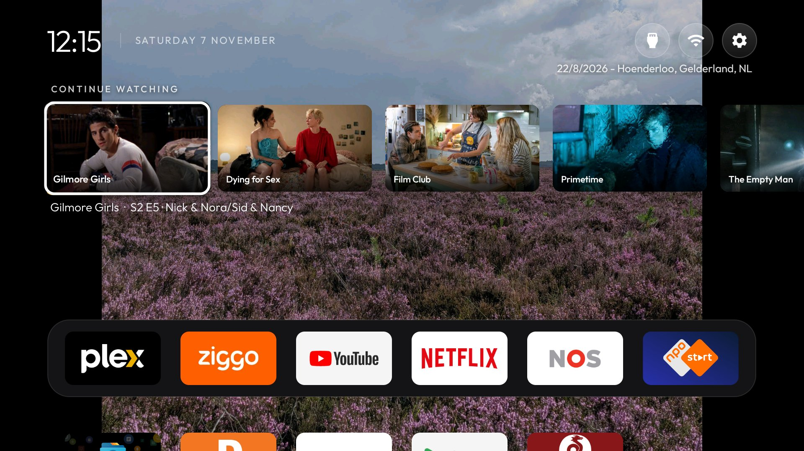 | Same, shelf focused. |
| v4 | 07/11/2026 | 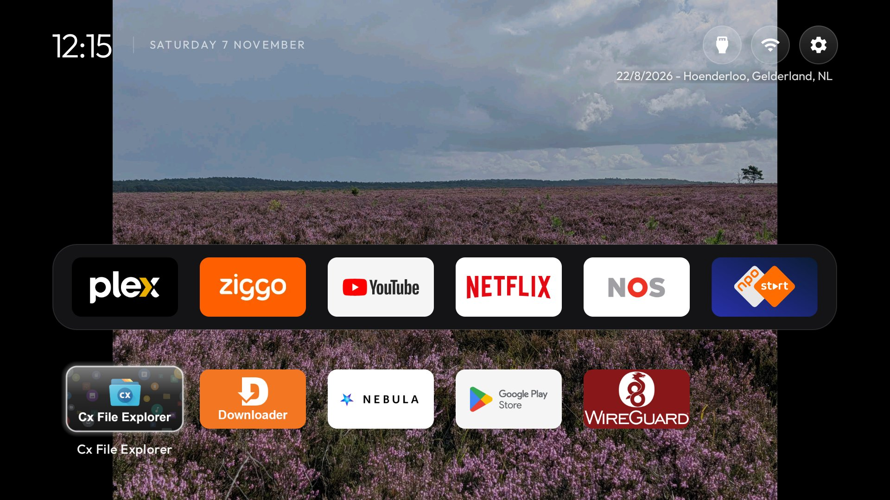 | Same, app grid: the shelf hides and the photo shows through. |
| v5 | 07/11/2026 | 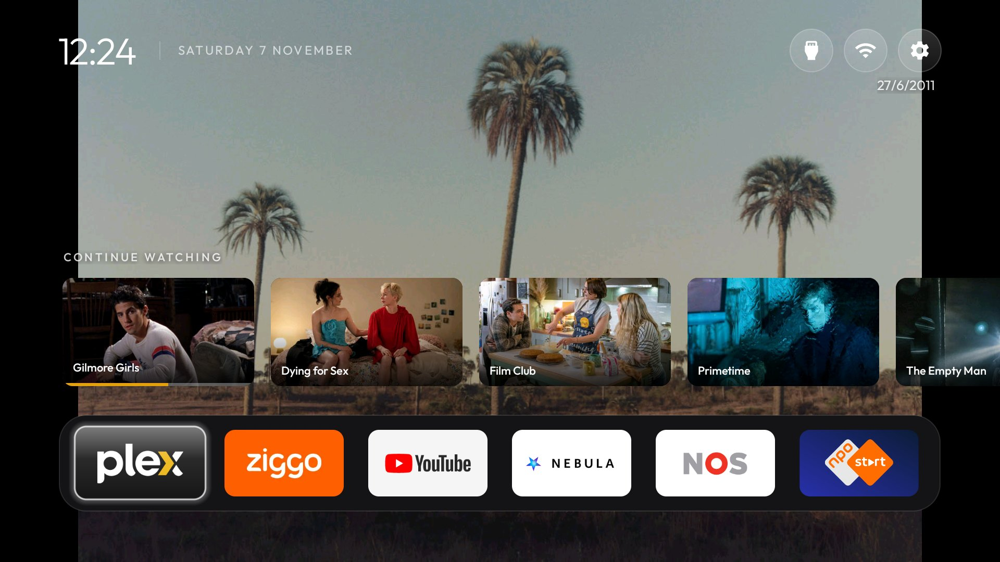 | Photo-frame layout: dock at the bottom (Plex / Ziggo / YouTube / Nebula / NOS / NPO Start), the Plex row just above it only while Plex has focus, grid rows hidden until Down. |
| v5 | 07/11/2026 | 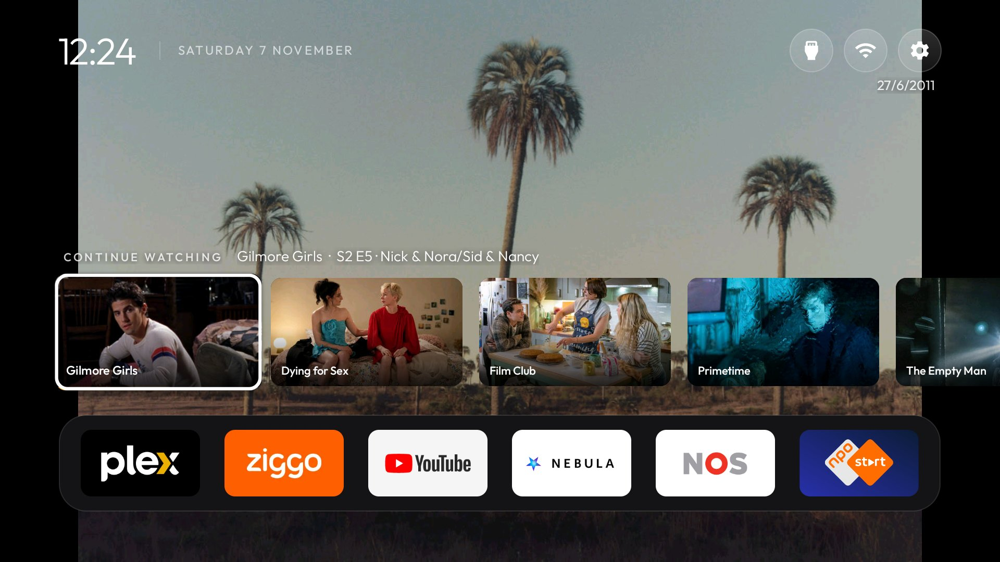 | Plex row focused: the episode title on the row's label line. |
| v5 | 07/11/2026 | 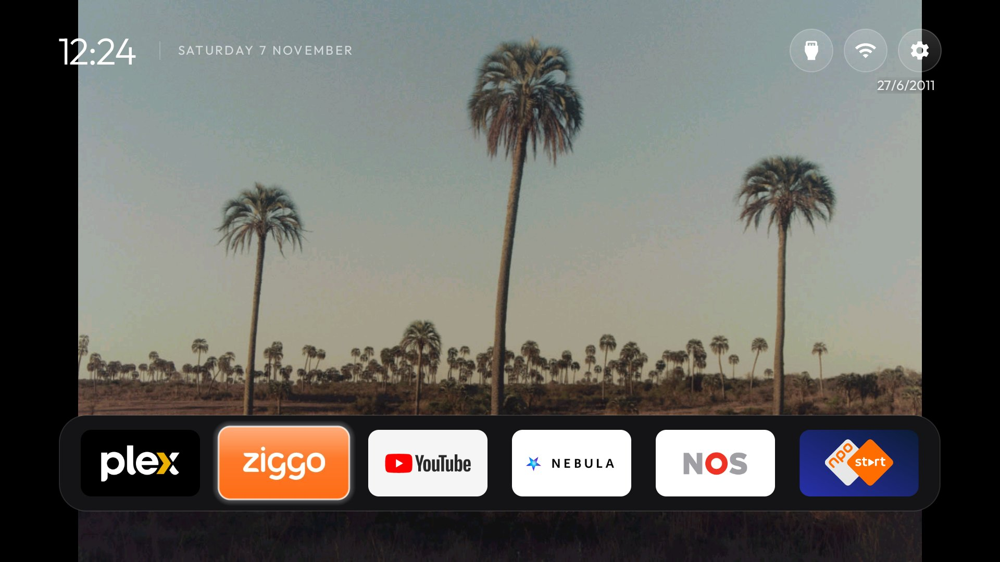 | Another dock app focused: no Plex row, just the photo. |
| v5 | 07/11/2026 | 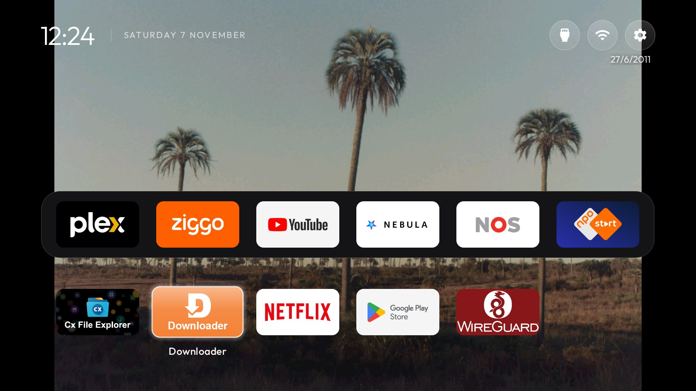 | Down into the app grid (Netflix moved here). |
| v5 | 07/11/2026 | 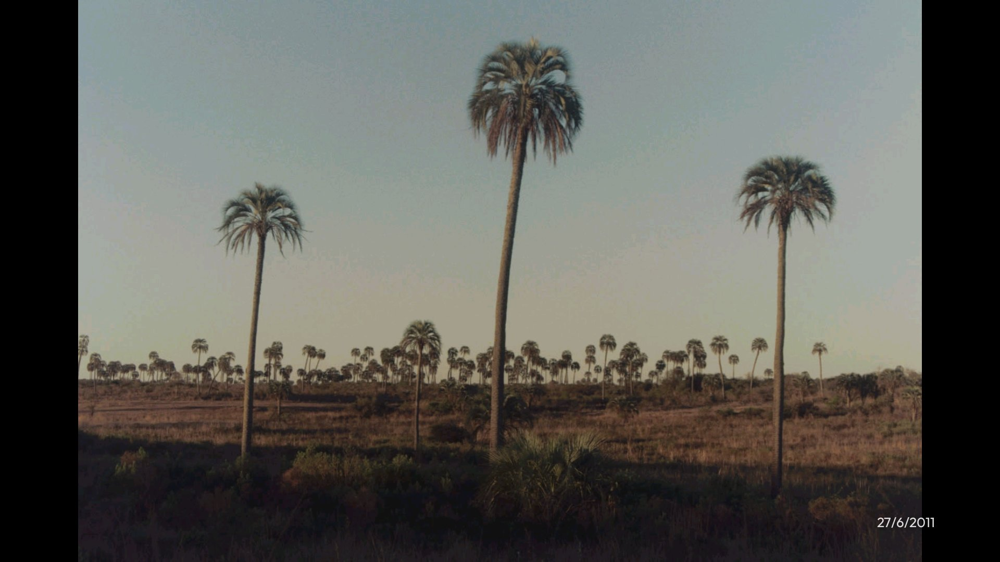 | After 8 s without a key: only the photo, caption in the bottom-right corner. |
| v5 | 07/11/2026 |  | The first key brings Home back without acting on it. |
